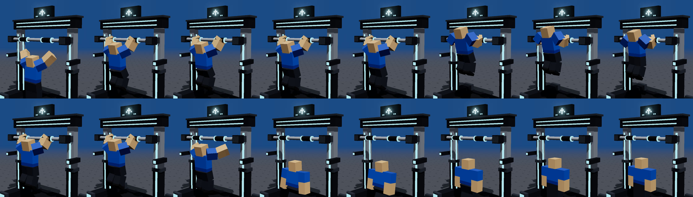

# Pull-Up Bars for Throw a Ragdoll

Nine pull-up bar models for Roblox. There is one for each treadmill tier in the reference video, and each bar uses the same colors, materials and decorations as its treadmill.


| Tier | Name | Matches the treadmill with… | Parts |
|---|---|---|---|
| 1 | Basic | dark steel, silver uprights, cyan neon strips, glowing foot caps, pixel console | 62 |
| 2 | Inferno | red frame, lava floor with chevrons, side wheels, horns with fire on the tips, embers | 119 |
| 3 | Celestial | white marble and gold, 4-point star in a gold oval, angel wings, clouds, halos | 236 |
| 4 | Void | obsidian with purple veins, galaxy-swirl portal, orbit rings, shards, rubble skirt | 399 |
| 5 | Frostbite | frost-cracked stone, ice spikes, chains, horned skull with glowing eyes, snow | 447 |
| 6 | Stormcastle | castle towers, gold spires, lightning-bolt crest, storm orb with sun rays, debris | 337 |
| 7 | Arcane | magenta runes, X-sigil tower, crown with white flame, peacock fans, chains | 409 |
| 8 | Blood Moon | cratered red moon with spikes, gothic spires, chains, bones and skulls | 446 |
| 9 | Toxic | emerald gothic spires, floating gems, X-sigil crest, chains, toxic bubbles | 386 |

## Getting them into Studio

Pick one of these:

* **All nine at once:** drag `roblox/PullUpBars.rbxmx` into Studio, or right-click in the Explorer and choose *Insert from File…*. You get a `PullUpBars` folder with all nine models.
* **One tier:** insert the file you want from `roblox/models/`.
* **No file import:** open a file from `roblox/luau/`, paste it into the Studio command bar and press Enter. The script builds the model in Workspace at the origin and selects it.

All parts are anchored. Only the base, mat, posts, header and grip bar can collide. Decorations have `CanCollide`, `CanTouch` and `CanQuery` turned off, so they won't block players or raycasts.

## Gameplay hooks

All nine bars have the same functional geometry, so one script works for every tier. The bar is 9.2 studs high, the footprint is 11 × 7 studs, and the front faces −Z.

* **Tag:** `PullUpBar`. You can find every bar with `CollectionService:GetTagged("PullUpBar")`.
* **Attributes on the model:** `Equipment = "PullUpBar"`, `Tier` (1–9), `TierName`.
* **PrimaryPart:** `Base`. The pivot is on the ground under the centre of the bar.
* **Attachments**
  * `GripBar.GripLeft` and `GripBar.GripRight`: where the hands go (±2 studs from the centre, a wide overhand grip).
  * `Base.StandPoint`: on top of the mat, directly under the bar. The animation system anchors the player here.
  * `Base.HangPoint`: a rough hanging position, if you write your own system.
  * `Base.EnterPoint`: in front of the station, for walking up or for a ProximityPrompt.
* **Folders inside each model:** `Frame` (functional parts), `Decor`, and `FX` (invisible parts that hold the ParticleEmitters and PointLights).

## Pull-up animation

`roblox/scripts/` holds a full pull-up system. Players walk up to their bar, press **E** (or tap the prompt), jump up and grab the bar, and do pull-ups. Pressing **Jump** lets them drop off and land.

The animation is procedural rather than a fixed keyframe file. Every frame, it solves the arms with IK so the hands stay locked on the grips for any R15 avatar: small, tall, Rthro or scaled. Hand-keyed animations can't do that.



One session plays out like this:

1. **Mount** (0.8 s): crouch, reach up, jump, catch the bar, swing and settle.
2. **Rep** (1.8 s by default): pull with eased acceleration, chin over the bar, squeeze at the top, a controlled lower, and a small settle at the bottom. The legs kick a little as the player pulls, the head looks up at the bar, and the body sways slightly.
3. **Dismount** (0.75 s): let go, drop straight down, absorb the landing with the knees, stand up. The player ends exactly in their normal pose.

### Add it to your game

This installs the animation, the upgrade shop and all nine bars in one go.

1. Drag `roblox/PullUpSystem.rbxmx` into Studio. It lands in Workspace as a `PullUpSystem` folder.
2. Open `roblox/InstallPullUpSystem.lua`, paste the whole file into the command bar and press Enter.

The installer moves each piece into its service (below) and replaces older copies with the same names, so running it again later updates the system. It also enables the server script, which stays disabled while it sits in Workspace. Then:

3. In `ReplicatedStorage.PullUp.Config`, set `Shop.Currency` to the name of your money leaderstat (default `"Cash"`), and set `Leaderstat` to your strength stat (default `"Strength"`).
4. Press Play. You get the Basic bar on a spot in front of the spawn.

| Goes in | What |
|---|---|
| ReplicatedStorage › `PullUp` | `Config`, `PullUpRig` (IK), `PullUpMotion` (the animation) |
| ServerScriptService › `PullUpServer` | starts `PullUpService` (sessions, reps) and `PullUpBarShop` (personal bars, upgrades) |
| StarterPlayer › StarterPlayerScripts › `PullUpClient` | draws the animation, HUD and toasts |
| ServerStorage › `PullUpBars` | the nine bar models the shop hands out |

If you'd rather insert pieces by hand, use the separate `roblox/PullUpAnimation_*.rbxmx` files for the scripts and `roblox/PullUpBars.rbxmx` for the bars (place that one in ServerStorage). If you use Rojo, sync `roblox/scripts/`; `PullUpServer/` becomes a Script with its two modules.

Any bar you place in Workspace yourself still works as a shared bar that anyone can use.

### Animation settings (`PullUp/Config`)

* `Mode`: `"Auto"` keeps repping until the player lets go. `"Tap"` does one rep per click, tap or R2 press.
* `Tempo` / `TempoByTier`: seconds per rep, for all bars or per tier.
* `Leaderstat` / `RewardByTier`: if the player has `leaderstats.Strength` (or whichever name you set), each rep adds the tier's reward. Set `Leaderstat = nil` to turn this off.
* `ShowHud`: a small rep counter with a "Jump to let go" hint.

### Hooking into your game

The server fires a BindableEvent for every rep, at the moment the chin goes over the bar:

```lua
local ServerStorage = game:GetService("ServerStorage")
ServerStorage:WaitForChild("PullUpRep").Event:Connect(function(player, tier, repCount)
	-- give strength / throw power, play a sound, update quests ...
end)
```

### How it works

* **`PullUpService`** (inside `PullUpServer`) handles the session. It anchors the HumanoidRootPart at the bar's `StandPoint` and adds a `PullUpSession` ObjectValue to the character, with the timing as attributes. It also counts reps, gives one player per bar, refuses ragdolled characters (any disabled Motor6D), and refuses bars owned by someone else.
* **`PullUpBarShop`** (inside `PullUpServer`) hands out personal bars, runs the in-order upgrades, saves tiers, and draws the sign and the Upgrade prompt.
* **`PullUpClient`** draws every player on a bar. It writes `Motor6D.Transform` in `RunService.PreSimulation`, after the Animator, so the default Animate script can stay as it is. The animation is a pure function of `workspace:GetServerTimeNow()`, so every client shows the same frame without sending poses over the network.
* **`PullUpMotion`** is the choreography and **`PullUpRig`** is the IK. You can tune the motion in `PullUpMotion`: the rep phase fractions, lean, leg kick and sway.
* R15 only. An R6 character gets a warning and isn't moved.

### Baked animation (optional)

If you also want normal Animation assets (for an NPC, a thumbnail, or your own animation pipeline):

1. Install the `PullUp` folder.
2. Select an R15 rig in Workspace.
3. Paste `roblox/scripts/Tools/BakePullUpAnimation.lua` into the command bar and press Enter.

You get `PullUp_Mount`, `PullUp_Loop` and `PullUp_Dismount` KeyframeSequences in `ServerStorage.PullUpAnimations`. Right-click one and choose *Save to Roblox* to get an animation ID. Baked keyframes only fit the rig they were baked on, so the live system above is the better choice for players.

### Tests

`tests/` runs the real Luau code in [Lune](https://github.com/lune-org/lune) with synthetic R15 avatars at 0.8×, 1× and 1.25× size, letting go both from a dead hang and from mid-rep. Each run checks that:

* the hands stay locked on the grips while repping;
* the head and torso never touch the bar;
* the feet stay off the floor while hanging;
* nothing produces NaNs;
* the player ends exactly in the rest pose.

`tests/shop.luau` buys every tier with a fake player and checks:

* upgrades go strictly in order (Basic through Toxic) and charge exactly the listed prices;
* purchases the player can't afford are refused;
* old bars are cleared and removed;
* tiers save and load;
* spots are handed out in order and reused.

The tests also check that every script compiles and that the bake tool builds valid KeyframeSequences. Run them with `cd pullup-bars && bash tests/run.sh`. `lune run tests/sim.luau 1 preview/animation.json` exports the frames the web preview plays.

## Upgrading pull-up bars

Every player gets their own bar. It starts as the lowest model, and each purchase replaces it with the next one up, in order:

**Basic → Inferno → Celestial → Void → Frostbite → Stormcastle → Arcane → Blood Moon → Toxic**

Tiers can't be skipped, and Toxic is the last one.

* **Buying.** Each player's bar has an **Upgrade** prompt (hold **F**, or Y on a gamepad) showing the price. A sign above the bar shows the owner, the current tier and the next tier's price. When a purchase goes through, the old bar is swapped for the next model with a burst of sparkles in the new tier's color and an "Upgraded to …!" toast. If the player is on the bar at the time, they drop off first, then the bar changes.
* **Your own shop UI.** Call the RemoteFunction `ReplicatedStorage.PullUp.BuyNextPullUpBar:InvokeServer()`. It returns `ok, message` and does the same purchase.
* **Prices** are in `Config.Shop.Prices`, one per tier. Tier 1 is free. Defaults: 500, 2.5K, 10K, 40K, 150K, 500K, 2M and 10M.
* **Rewards.** Higher tiers give more per rep (`Config.RewardByTier`), so each upgrade makes training faster.
* **Saving.** Tiers save in a DataStore (`Config.Shop.DataStoreName`). To test saving in Studio, turn on *Game Settings › Security › Enable Studio Access to API Services*.
* **Where bars go.** Tag any parts `PullUpBarSpot` (use the Tag Editor or the Properties panel). Each player gets the next free spot in `Order` attribute order. The bar sits on top of the part, with its open side facing the part's front. If the place has no spots, `Config.Shop.AutoSpots` (8) pads are created in a row in front of the SpawnLocation, so it works right away.
* **Owner only.** Other players can't use or upgrade your bar; their prompts are hidden. Turn this off with `Config.Shop.OwnerOnly = false`.

### Using your own currency or save data

```lua
local Shop = require(game.ServerScriptService.PullUpServer.PullUpBarShop)

-- pay with your own currency system instead of leaderstats
Shop.Charge = function(player, price)
	if MyMoney.Get(player) < price then
		return false, "Not enough coins"
	end
	MyMoney.Remove(player, price)
	return true
end

-- if your data system saves the tier, set Config.Shop.DataStoreName = nil and:
Shop.SetTier(player, savedTier)        -- when their data loads
print(Shop.GetTier(player))            -- 1..9; also on player:GetAttribute("PullUpBarTier")
game.ServerStorage.PullUpBarTierChanged.Event:Connect(function(player, tier)
	-- save it, update your UI, give a badge ...
end)
```

The progression comes from the models in `ServerStorage.PullUpBars`, sorted by their `Tier` attribute. Adding a tier 10 model there adds a tenth upgrade; also add its price to `Config.Shop.Prices`.

## Editing the designs

All of the models are generated by `generator/`, so it is the single source of truth:

```
pip install numpy
python3 pullup-bars/generator/build.py
```

* `generator/themes.py` has the shared frame and one function per tier. Change colors, add props or rename tiers here.
* `generator/core.py` has the part builder and the voxel shape helpers: rings, chains, spires, gems, crystals, rubble, wings, fans, skulls and more.
* `generator/emit.py` writes the `.rbxmx` files, the Luau build scripts and the preview data.

Running the build regenerates the models, the script bundles and the preview. Open `preview/index.html` in a browser for an orbitable 3D view with bloom, particles and an R15 ragdoll performing the pull-up animation.
