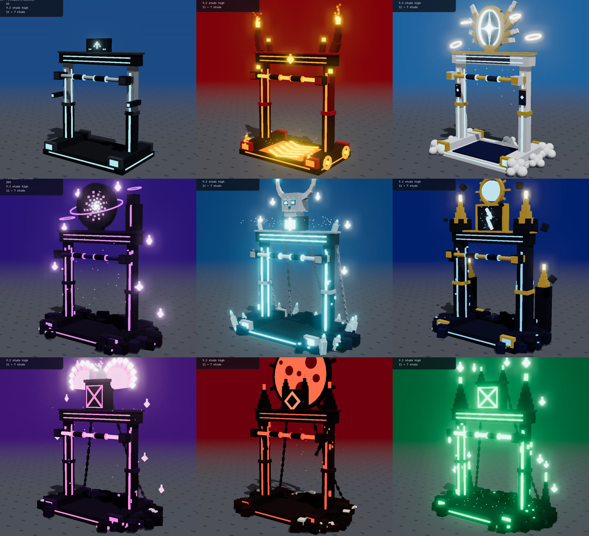

# Pull-Up Bars for Throw a Ragdoll

Nine pull-up bar models for Roblox. There is one for each treadmill tier in the reference video, and each bar uses the same colors, materials and decorations as its treadmill.



| Tier | Name | Matches the treadmill with… | Parts |
|---|---|---|---|
| 1 | Basic | dark steel, silver uprights, cyan neon strips, glowing foot caps, pixel console | 62 |
| 2 | Inferno | red frame, lava floor with chevrons, side wheels, horns with fire on the tips, embers | 119 |
| 3 | Celestial | white marble and gold, 4-point star in a gold oval, angel wings, clouds, halos | 236 |
| 4 | Void | obsidian with purple veins, galaxy-swirl portal, orbit rings, shards, rubble skirt | 399 |
| 5 | Frostbite | frost-cracked stone, ice spikes, chains, horned skull with glowing eyes, snow | 447 |
| 6 | Stormcastle | castle towers, gold spires, lightning-bolt crest, storm orb with sun rays, debris | 337 |
| 7 | Arcane | magenta runes, X-sigil tower, crown with white flame, peacock fans, chains | 409 |
| 8 | Blood Moon | cratered red moon with spikes, gothic spires, chains, bones and skulls | 446 |
| 9 | Toxic | emerald gothic spires, floating gems, X-sigil crest, chains, toxic bubbles | 386 |

## Getting them into Studio

Pick one of these:

* **All nine at once:** drag `roblox/PullUpBars.rbxmx` into Studio, or right-click in the Explorer and choose *Insert from File…*. You get a `PullUpBars` folder with all nine models.
* **One tier:** insert the file you want from `roblox/models/`.
* **No file import:** open a file from `roblox/luau/`, paste it into the Studio command bar and press Enter. The script builds the model in Workspace at the origin and selects it.

All parts are anchored. Only the base, mat, posts, header and grip bar can collide. Decorations have `CanCollide`, `CanTouch` and `CanQuery` turned off, so they won't block players or raycasts.

## Gameplay hooks

All nine bars have the same functional geometry, so one script works for every tier. The bar is 9.2 studs high, the footprint is 11 × 7 studs, and the front faces −Z.

* **Tag:** `PullUpBar`. You can find every bar with `CollectionService:GetTagged("PullUpBar")`.
* **Attributes on the model:** `Equipment = "PullUpBar"`, `Tier` (1–9), `TierName`.
* **PrimaryPart:** `Base`. The pivot is on the ground under the centre of the bar.
* **Attachments**
  * `GripBar.GripLeft` and `GripBar.GripRight`: where the hands go (±1.3 studs from the centre).
  * `Base.HangPoint`: where the HumanoidRootPart should sit while the player hangs.
  * `Base.StandPoint`: on the mat, directly under the bar.
  * `Base.EnterPoint`: in front of the station, for walking up or for a ProximityPrompt.
* **Folders inside each model:** `Frame` (functional parts), `Decor`, and `FX` (invisible parts that hold the ParticleEmitters and PointLights).

## Editing the designs

All of the models are generated by `generator/`, so it is the single source of truth:

```
pip install numpy
python3 pullup-bars/generator/build.py
```

* `generator/themes.py` has the shared frame and one function per tier. Change colors, add props or rename tiers here.
* `generator/core.py` has the part builder and the voxel shape helpers: rings, chains, spires, gems, crystals, rubble, wings, fans, skulls and more.
* `generator/emit.py` writes the `.rbxmx` files, the Luau build scripts and the preview data.

Running the build regenerates everything in `roblox/` and `preview/`. Open `preview/index.html` in a browser for an orbitable 3D view with bloom, particles and a blocky character on the bar for scale.
